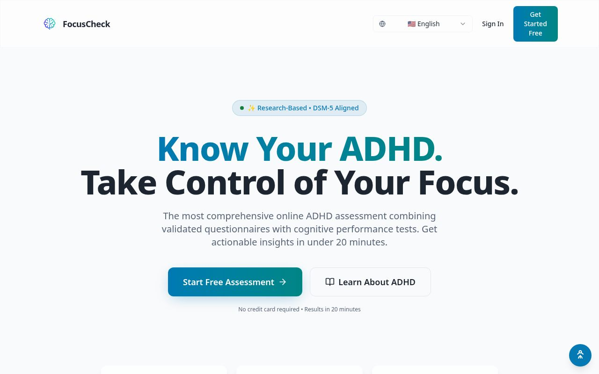
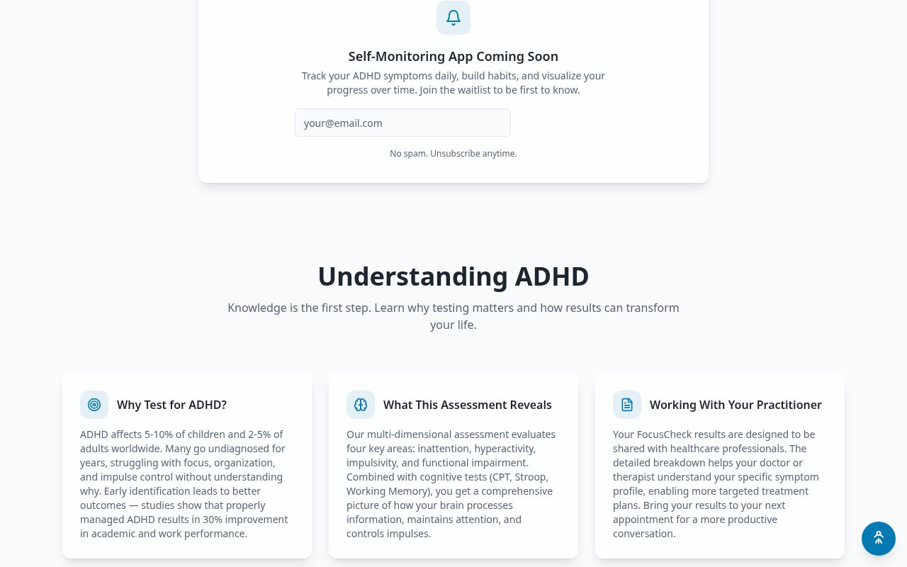
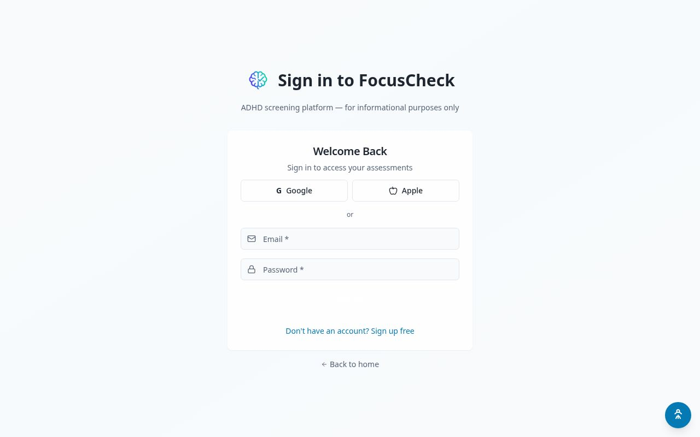
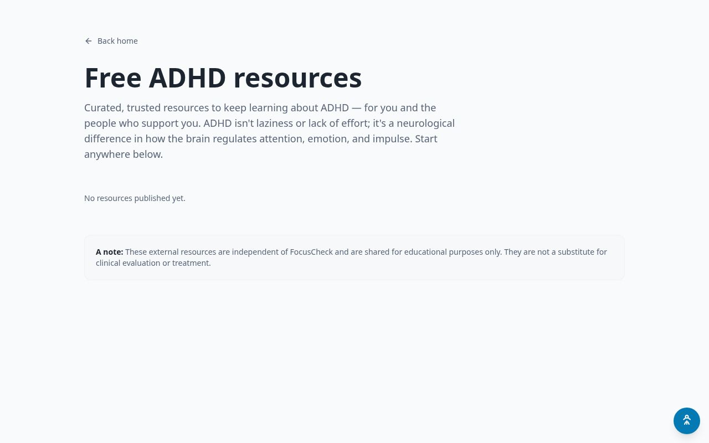

# FocusCheck

An educational ADHD screening research prototype combining age-adapted questionnaires with attention, working memory, and response-inhibition tasks. This README is the repository's product, research, and development record; its screenshots render directly on GitHub.

**Preview / live app:** https://focuschecklife.lovable.app

**Project domain:** focuscheck.life (domain configuration is separate from the preview address).

**Documentation updated:** 12 November 2026.

> **Research prototype — pending clinical trials.** FocusCheck is for research and educational use only. It is not a medical device, does not diagnose ADHD, and does not provide medical advice. Every score, report, and AI interpretation is provisional and voidable. Do not use any output for self-diagnosis, treatment decisions, or starting, stopping, or changing medication. Consult a qualified healthcare practitioner for a full evaluation.

## Contents

- [Objective and intended audience](#objective-and-intended-audience)
- [Product development and attribution](#product-development-and-attribution)
- [Screenshots](#screenshots)
- [Product capabilities](#product-capabilities)
- [Research foundations and sources](#research-foundations-and-sources)
- [Assessment procedure and scoring](#assessment-procedure-and-scoring)
- [How AI interprets results](#how-ai-interprets-results)
- [Privacy, consent, and security](#privacy-consent-and-security)
- [Development history and fixes](#development-history-and-fixes)
- [Testing and verification](#testing-and-verification)
- [Architecture and local development](#architecture-and-local-development)
- [Limitations and remaining work](#limitations-and-remaining-work)

## Objective and intended audience

FocusCheck gives people an accessible first step to reflect on attention and behaviour, learn about ADHD, and prepare questions for a practitioner. It does not establish whether someone has ADHD.

- **Adults and teens:** reflect on everyday experiences through age-adapted self-report questions.
- **Parents and guardians:** complete parent-mediated observations for children aged 6–12.
- **People seeking support:** review educational results and find trusted resources or professional-support options.
- **Research and product teams:** investigate whether a consent-aware, accessible screening experience helps people understand their next steps.

The product objective is to connect questionnaire responses with task performance without presenting either as a clinical conclusion. The project success measure is completed assessments whose results are shown to the person who took them, each month—not diagnoses or treatment outcomes.

## Product development and attribution

**Aloke Diddi — project initiator and product direction.** The project requests attribute its development to Aloke Diddi. The recorded product direction includes age-adapted screening, parent/guardian onboarding, accessible presentation, international language and pricing support, consent-aware reporting, a support-oriented CRM, and research-only disclaimers.

This is a summary of the project's recorded requirements, not a verified professional biography or a claim of clinical credentials. Additional expert contributors, their qualifications, and their specific reviews have not been supplied; no unnamed expert review or endorsement is claimed.

The clinicians and researchers cited below are **authors of external reference materials**, not confirmed project collaborators. Published research informs the prototype; it does not validate this implementation or indicate endorsement by those authors, their institutions, or instrument publishers.

### Development approach

1. Define the educational purpose, intended age groups, consent requirements, and non-diagnostic language.
2. Use published ADHD and cognitive-task literature to inform questionnaire domains and task concepts.
3. Build onboarding, questionnaires, timed tasks, and plain-language results as one user journey.
4. Add paid-report access, cached AI summaries, international pricing, and user-requested translation.
5. Add administrative content, learning resources, waitlist management, and consent-aware lead records.
6. Review software behaviour, privacy boundaries, accessibility, and operational failures; retain unresolved work separately from completed fixes.

## Screenshots

These existing product captures illustrate the interface, not clinical evidence or proof that every workflow has passed testing. They may differ from subsequent changes. Screenshots are documented here rather than displayed on the site's research page; no private account, assessment, or CRM screenshots are included.

### Home page



### Plans and pricing



### Account and consent



### Learning resources



## Product capabilities

| Area | Implemented scope |
| --- | --- |
| Account and onboarding | Account access, social sign-in integration, self versus parent/guardian context, age range, experiences, and profile details. Provider availability depends on deployed configuration. |
| Questionnaires | Age-adapted questions covering inattention, hyperactivity, impulsivity, and functional impairment; parent-mediated child forms. |
| Cognitive tasks | Continuous Performance Test (CPT), working memory, and Stroop-style tasks completed in one sitting. |
| Results | Indicative score bands, category summaries, symptom radar, educational next steps, result-saving and sharing consent, and learning-resource links. |
| Full report | Paid or eligible coupon unlock, AI interpretation, on-demand report translation, and PDF export. Free views use dummy premium text and blur overlays rather than generating premium AI content. |
| Pricing | CAD-based package management, optional sale prices, country-based currency detection, exchange-rate conversion, and clean-price rounding. |
| Checkout | Hosted Stripe checkout and payment verification. Wallet availability depends on Stripe support, region, browser, device, and account settings; universal Samsung Pay support is not claimed. |
| Languages | Configurable language selection, database-backed interface translations, and administrative translation generation. Availability and completeness require deployment checks. |
| Accessibility | Light, dark, and high-contrast themes, font scaling, skip navigation, and keyboard-accessible controls; WCAG 2.1 AA is a target, not a certified audit result. |
| Admin CMS | Packages, resources, FAQs/content settings, translations, promotional codes, and configurable support options. |
| Admin CRM | Profile and location fields, test metadata, attempts/progress, qualification and support interest, consent and marketing preferences, payment references, invoices, waitlist subscribers, and reminder actions. |
| Email | Shared transactional-email templates, assessment reminders, queued delivery, and unsubscribe handling. |
| Agent integration | OAuth consent with user-scoped tools for profile, assessment history, individual reports, packages, and resources. |
| Self-monitoring | Waitlist only. A complete longitudinal self-monitoring app is not available. |

## Research foundations and sources

**Important distinction:** the source instruments have their own evidence bases; FocusCheck's adapted questions, weights, task implementations, score bands, and AI summaries have not been clinically validated. Do not describe the combined prototype as a validated diagnostic test or a licensed implementation of a commercial scale.

| Reference | Relevance to the prototype | Source |
| --- | --- | --- |
| DSM-5 / DSM-5-TR | Symptom-domain framework and the distinction between symptoms, impairment, and clinical diagnosis. The prototype is not a full diagnostic interview. | American Psychiatric Association (2022), *Diagnostic and Statistical Manual of Mental Disorders*, text revision. [Publisher information](https://www.psychiatry.org/psychiatrists/practice/dsm) |
| Adult ADHD Self-Report Scale, ASRS v1.1 | Adult self-report screening concepts; the published screener's validation does not transfer automatically to adapted items. | Kessler et al. (2005), *Psychological Medicine*, 35(2), 245–256. [DOI](https://doi.org/10.1017/S0033291704002892) |
| Conners parent-rating literature | Parent-observed behaviour and the importance of multiple settings. The app does not claim to administer an official Conners 3 assessment. | Conners (2008), *Conners 3rd Edition*, Multi-Health Systems. [Publisher](https://mhs.com/) |
| Continuous Performance Test | Sustained-attention task concepts: missed targets, false alarms, and reaction time. Prototype results are not standardized clinical CPT norms. | Rosvold et al. (1956), *Journal of Consulting Psychology*, 20(5), 343–350. [DOI](https://doi.org/10.1037/h0043220) |
| Working memory | Theoretical basis for short-term maintenance and manipulation of information. | Baddeley (2000), *Trends in Cognitive Sciences*, 4(11), 417–423. [DOI](https://doi.org/10.1016/S1364-6613(00)01538-2) |
| Stroop interference | Response interference and inhibition task concepts. | Stroop (1935), *Journal of Experimental Psychology*, 18(6), 643–662. [DOI](https://doi.org/10.1037/h0054651) |
| Executive-function theory | Background on inhibition and everyday attention difficulties; not a causal explanation for an individual user's scores. | Barkley (1997), *Psychological Bulletin*, 121(1), 65–94. [DOI](https://doi.org/10.1037/0033-2909.121.1.65) |

### Online educational resources

- [NIMH: ADHD](https://www.nimh.nih.gov/health/topics/attention-deficit-hyperactivity-disorder-adhd) — public information on symptoms, evaluation, and support.
- [CDC: ADHD](https://www.cdc.gov/adhd/) — educational information, particularly for children and families.
- [NICE guideline NG87](https://www.nice.org.uk/guidance/ng87) — guidance on professional diagnosis and management; not a protocol implemented by this app.
- [CHADD](https://chadd.org/) — educational and support resources.
- [ADDA](https://add.org/) — adult ADHD community and educational resources.

The site's `/resources` page contains CMS-managed learning links. These materials support education, not an assertion that a prototype score is clinically accurate. Publication access, instrument permissions, translation validity, and attribution requirements must be reviewed before formal research deployment.

## Assessment procedure and scoring

1. **Account and consent:** collect the necessary account/profile information and explicit consent choices. Result saving, result sharing, and marketing preferences are distinct decisions.
2. **Onboarding and age selection:** establish whether the participant is answering for themselves or a child, and select the age-appropriate questionnaire and task settings.
3. **Questionnaire:** collect frequency responses in the four symptom/impact domains. Current scoring uses question weights and a maximum response value of three.
4. **Cognitive tasks:** run CPT, working memory, and Stroop-style tasks in one sitting. Interrupted assessments cannot be resumed.
5. **Score display:** calculate weighted questionnaire category scores as percentages of their possible maximum. The current dashboard uses prototype bands of below 40%, 40% to below 70%, and 70% or above. These are application heuristics, not validated probability estimates or DSM diagnostic thresholds.
6. **Results and consent:** show an educational summary, offer saving/sharing choices, and point to resources or practitioner support. Saved result insertion increments the attempt count through a database trigger.
7. **Optional unlock:** payment or an eligible coupon unlocks premium report areas. Free users have a maximum of two attempts under the app's access rule.

Task metrics and questionnaire percentages are presented together, but a scientifically validated combined diagnostic score is not established. A full ADHD evaluation also considers developmental history, symptoms across settings, impairment, alternative explanations, and professional judgement.

## How AI interprets results

The AI produces a narrative summary **after scoring**; it is not the task engine, a practitioner, or a diagnostic model.

### Inputs and output

The current generation prompt includes:

- Age group and questionnaire category percentages/levels.
- CPT correct hits, missed targets, false alarms, and average reaction time.
- Working-memory correct/incorrect responses and maximum task level.
- Stroop correct responses, average reaction time, and congruent/incongruent accuracy.

The prompt does not include name, email, city, raw click streams, or onboarding free text. It asks for an English-language summary, survey and task findings, strengths, practical suggestions, and topics to discuss with a healthcare professional. This is prompt-based language generation—not comparison against a verified clinical normative dataset or a live literature search. No retrieval-backed citation verification is implemented in this flow.

### Access, caching, and translation

- Premium generation is gated in the UI and by a server-side paid-access check.
- The dashboard first loads a saved English interpretation for the assessment; ordinary reopening reuses that text.
- Generated English text is stored on the assessment. Taking another assessment creates a separate result and interpretation.
- Translation happens only when the user requests it. Existing translations are cached by language.
- **Known limitation:** generation itself does not enforce a server-side cache-first/idempotency lock. Concurrent or direct repeat requests can regenerate text; a strict guarantee of exactly one AI call per assessment is not yet established.

### Safety limits

An AI response can misinterpret patterns, invent explanations, or sound more authoritative than the evidence supports. Sleep, stress, other conditions, medication, device latency, distraction, and the testing environment can affect performance. The model lacks a clinical interview and complete medical history. Translations can introduce additional errors.

**No output is suitable for self-diagnosis or treatment. Reports are provisional and voidable. Always consult a qualified practitioner.**

## Privacy, consent, and security

- Explicit terms/privacy agreement and separate email/push marketing preferences are captured in account/profile flows.
- Result sharing is opt-in and separate from ordinary account access.
- The project's retention policy calls for unconsented data to be purged after seven days; operational enforcement must be checked in the deployed environment.
- User-scoped records use row-level access controls; administrative actions require privileged access.
- Payment state is protected against client-side self-updates, and payment verification checks the purchaser's identity.
- Promo redemption uses a controlled server-side operation instead of exposing administrative code records.
- AI and agent-report access require authorization; agent clients connect through user consent.
- Financial actions and email delivery are handled server-side. Private credentials must never be committed or included in screenshots.

These are implemented protections and documented policies, not an independent security certification or legal compliance opinion.

## Development history and fixes

The following summarizes the recorded development work. A recorded change is not proof that every production path has been independently retested.

| Phase | Work and issues addressed |
| --- | --- |
| Screening experience | Landing/navigation review, age-adapted questionnaire/task flow, result summaries, FAQ and accessibility controls. |
| Future monitoring | Added home and post-results waitlist options instead of presenting an unbuilt monitoring app as available. |
| Consent and CRM | Expanded profile/location fields, separate marketing opt-ins, result-sharing consent, test metadata, qualification/support interest, and waitlist profiles. |
| AI cost controls | Locked premium sections for free users, added saved English interpretations, and moved translation to explicit user requests with per-language caching. |
| Payment security | Blocked client payment-status edits, checked checkout ownership, and secured coupon redemption. |
| Data-access hardening | Tightened public settings exposure, administrative policies, function permissions, and authenticated function handling. |
| International pricing | Added CAD-managed packages/sale prices, country-based currency detection, exchange-rate refresh, and price rounding. |
| Learning and branding | Added curated resources, report resource prompts, project identity assets, page metadata, structured data, and legal-domain references. |
| Account journey | Added onboarding and improved sign-in/navigation and language-switcher behaviour. Social-provider operation still depends on deployment settings. |
| Reports and operations | Added assessment and invoice PDFs, CRM reminder templates, email queue handling, and unsubscribe support. |
| Launch fixes | Moved attempt counting to a result-insert trigger, added retry feedback for failed saves, and loading/error feedback for checkout. |
| Verification tooling | Added shared pricing/access-rule utilities and six unit tests; pinned a compatible Vitest version after a Vite compatibility failure. |
| Repository documentation | Consolidated objectives, research references, procedures, AI limitations, screenshots, and unfinished verification here without promotional platform branding. |

## Testing and verification

### Automated tests currently in the repository

`src/lib/pricing.test.ts` contains six tests covering:

1. Decimal-currency rounding (for example, USD 6.42 → 6.99).
2. Zero-decimal-currency rounding (for example, JPY 487 → 499).
3. Free prices remaining zero.
4. A free user's second attempt remaining available.
5. Blocking a free user after two attempts.
6. Paid users not being blocked by the free-attempt limit.

Run them with `npx vitest run src/lib/pricing.test.ts`. These tests verify software rules, **not clinical accuracy**, payment delivery, database-trigger behaviour, or end-to-end access control.

### Release verification procedure

- Check home navigation, pricing cards, FAQ, and accessibility controls on desktop and mobile.
- Register/sign in with a confirmed account, complete onboarding, and verify profile details read back correctly.
- Complete a full assessment; verify results save, history reads them back, and the attempt count changes once.
- Confirm free reports stay locked without AI generation; verify payment/coupon unlock in an authorized test environment.
- Reopen an unlocked report and check cached text; request translation twice to verify reuse.
- Verify country/currency selection, package conversion, language switching, and translated content.
- Test an authorized admin account for CRM detail, waitlist records, consent, reminders, invoice/report downloads, and CMS updates.
- Confirm delivery of a real consent-appropriate reminder and its unsubscribe flow.
- Inspect security findings, browser errors, and access-denial paths before release.

Earlier development notes record browser checks, but there is no committed full end-to-end suite or comprehensive clinical study. This documentation update does not imply a fresh successful run of all the procedures above. In particular, real reminder delivery and the complete paid/authenticated journey require separate verification.

## Architecture and local development

The app uses React 18, TypeScript, Vite, shadcn/ui, UnoCSS, TanStack Query, and React Router. Backend authentication, data, and server-side functions are hosted; Stripe handles checkout. PDF generation uses React PDF. Agent tools are OAuth-protected and user-scoped.

| Location | Responsibility |
| --- | --- |
| `src/pages/` | Public, account, onboarding, administrative, and informational screens. |
| `src/components/` | Assessment, results, reusable UI, and admin tools. |
| `src/data/assessmentQuestions.ts` | Age-adapted questionnaire items, domains, source labels, and weights. |
| `src/lib/pricing.ts` | Shared price-rounding and free-attempt access rules. |
| `src/lib/pdf/` | Assessment report and invoice documents. |
| `src/lib/mcp/` | Agent tool definitions and user-scoped data access. |
| `supabase/functions/` | Server-side AI, checkout verification, currencies, translations, email, and agent integration. |
| `supabase/migrations/` | Versioned database/schema changes. |

Requires Node.js and npm. Clone this repository using its actual GitHub URL, open its directory, then run:

```sh
npm install
npm run dev
```

Configure the public backend connection variables expected by the application in your local environment: `VITE_SUPABASE_URL`, `VITE_SUPABASE_PUBLISHABLE_KEY`, and `VITE_SUPABASE_PROJECT_ID`. Obtain the legitimate values from the project configuration; never substitute a privileged server key. Hosted functions require their own server-side configuration. Running the frontend alone does not recreate the backend, payment account, OAuth providers, or email setup.

```sh
npx vitest run src/lib/pricing.test.ts
npm run lint
npm run build
```

Do not commit private keys, session tokens, personal test data, or local environment files. Changes to hosted functions and database migrations require separate deployment/application; a GitHub commit alone does not deploy them.

## Limitations and remaining work

- **Clinical validation:** pending clinical trials. No sensitivity, specificity, diagnostic accuracy, or treatment efficacy is claimed.
- **Instrument review:** adapted questionnaire scoring, task norms, permissions, and language equivalence need qualified review before formal study use.
- **Contributors:** additional expert names, credentials, and review scope remain unconfirmed.
- **AI generation:** strengthen server-side cache-first/idempotent generation before claiming exactly one generation per assessment.
- **Verification:** perform and retain authenticated paid/coupon, reminder-delivery, retention, and access-control checks; add broader automated coverage.
- **Code quality:** the results dashboard/service-layer refactor and remaining administrative type cleanup are follow-up work.
- **Search tooling:** Google Search Console requires owner authorization.
- **Monitoring:** the self-monitoring product remains a waitlist, not a complete feature.

**Use this prototype to support learning and questions for a practitioner—not to diagnose yourself or choose treatment.**
